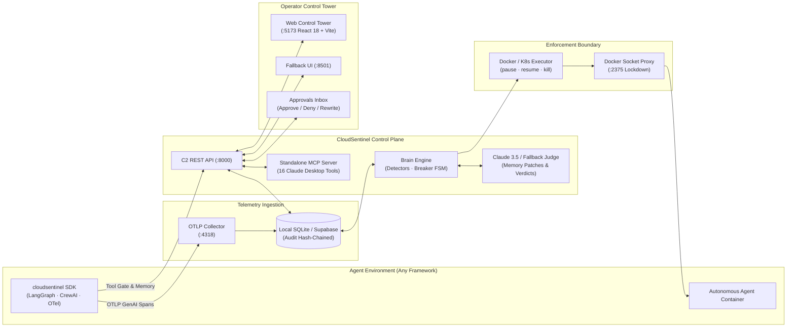

# 🛡️ CloudSentinel

**The Circuit Breaker and Control Tower for AI Agent Fleets.**  
CloudSentinel monitors autonomous AI agents through standard OpenTelemetry spans. When an agent loops, overspends, leaks secrets, or attempts an unauthorized tool call, CloudSentinel **pauses, heals, or kills** it within seconds from *outside* the agent's code—where broken or compromised agents cannot bypass it. It then proves exact dollar ROI saved.

> *"AgentOps tools are the black-box flight recorder. CloudSentinel is the circuit breaker."*

Built for the **International AI Builders Congress 2026 · InfraSphere AI · AgentOps** challenge.

---

## 🏗️ Architecture



---

## ⚡ The 5 Core Capabilities (Mapped to Challenge Prompts)

| # | Prompt Capability | CloudSentinel Implementation | Verified Live Proof |
|:---:|:---|:---|:---|
| **P1** | **Token-Flow & Loop Dashboard** | Live $/min, token rates, and `@xyflow/react` interactive node flow graph where recursive cycles turn red and pulse. | Node cycle counter stops the moment an agent is paused; full time-travel incident replay. |
| **P2** | **Outside Circuit Breaker** | 3-tier defense: Hard limits ($< 2$s kill) $\rightarrow$ Semantic loop detector (3–5s pause, 0 LLM calls) $\rightarrow$ Claude judge for gray-zones. | Paraphrase loops caught in **3.0s**; 0 false kills on bursty healthy traffic. |
| **P3** | **Command & Control API + MCP** | REST API + 16-tool MCP server. Edit agent memory beliefs, and approve, deny, or **rewrite** held tool calls. | Rewriting a 50,000 BDT refund to 500 BDT in real time; managing fleet from Claude Desktop. |
| **P4** | **OTel Telemetry SDK** | Native drop-in SDK emitting OTel GenAI semantic conventions; 1-line LangGraph & CrewAI adapters; Arize Phoenix dual-export. | Monitored real framework agents with 1 line of code; zero vendor telemetry lock-in. |
| **P5** | **ROI Attribution Engine** | Prices every intervention in real dollars saved using calibrated horizon formulas. Attributes costs and waste per task. | Prevents $> 96\%$ of runaway token waste; verifiable hash-chained audit log. |

---

## 🚀 Quick Start (Local Offline Mode — No Keys Required)

You can run CloudSentinel locally on Windows, macOS, or Linux without Docker, cloud accounts, or API keys:

```bash
git clone https://github.com/abdullahalyf/Cloud-Sentinel.git && cd Cloud-Sentinel
python -m venv .venv
# Activate venv:
# Windows PowerShell: .venv\Scripts\Activate.ps1
# Linux/macOS:        source .venv/bin/activate

pip install -r requirements.txt
python scripts/check_setup.py

# Terminal 1: Brain + C2 API + Simulated Fleet
python -m brain --fake

# Terminal 2: Web Control Tower (React 18)
cd dashboard/web && npm install && npm run dev    # http://localhost:5173
# (Or run Streamlit fallback: streamlit run dashboard/app.py)
```

### Windows One-Command Rehearsal
On Windows, run the automated rehearsal script to boot all services in one step:
```powershell
powershell -ExecutionPolicy Bypass -File scripts/demo_local.ps1 -Fresh -SkipInstall
```

---

## 🐳 Full Stack in Docker (With Socket Proxy Lockdown)

```bash
# Start all containers (Docker-proxy, Brain, Web Dashboard :5173, Collector :4318, 4 Agents)
docker compose up -d --build

# Run simulated incidents:
python scripts/demo.py rogue beta paraphrase_loop    # Loops on Order 4471 -> Paused in 3s
python scripts/demo.py fix beta                      # Heals memory belief
python scripts/demo.py resume beta                   # Resumes beta to probation -> healthy
python scripts/demo.py rogue delta bad_tool_call     # 50,000 BDT refund held in Approvals Inbox
python scripts/demo.py rogue gamma token_bomb        # Token bomb -> Killed in < 2s

# Reset demo back to clean state:
python scripts/demo.py reset
```

---

## 🤖 Operate via Claude Desktop (Model Context Protocol)

Add CloudSentinel's standalone MCP server to your `claude_desktop_config.json`:

```json
{
  "mcpServers": {
    "cloudsentinel": {
      "command": "python",
      "args": ["-m", "brain.mcp_server"],
      "env": {
        "CS_API_URL": "http://localhost:8000"
      }
    }
  }
}
```
Ask Claude:
> *"Which agent is burning the most budget tonight? Pause it, inspect its memory, and explain why."*

---

## 📊 Measured Performance & Evidence Benchmarks

All performance claims are backed by reproducible commands in `docs/research/pitch-numbers.md`:
* **Scale Proof (1,000 Agents):** Decision tick p95 is **12.9 ms** (1.3% of the 1,000 ms budget). (`python -m brain.scale_bench --agents 1000 --repeats 3`)
* **Security Precision & Recall:** **1.0 Precision / 1.0 Recall** across 115 labeled cases for prompt injection, secret leakage, and tool poisoning. (`python -m brain.security measure --cases brain/eval_data/security.jsonl`)
* **Runaway Benchmark:** 100% pass rate across all failure scenarios; 96.6%–98.8% waste reduction. (`python -m eval.harness --compare`)
* **Tamper-Evident Audit:** Cryptographic hash-chain validation passes with zero broken links. (`python -m brain.audit verify`)

---

## 📚 Documentation & Hackathon Artifacts

* [Submission Draft (All 8 Sections)](docs/research/submission-draft.md)
* [10-Slide Pitch Deck & 4-Minute OBS Video Script](docs/research/pitch-deck-and-script.md)
* [STRIDE Threat Model & Top Judge Q&A](docs/research/judge-qa-and-threat-model.md)
* [Reproducible Pitch Numbers & Benchmarks](docs/research/pitch-numbers.md)
* [20-Point Manual/Automated QA Checklist](eval/QA.md)
* [With vs Without Evaluation Results](eval/RESULTS.md)
* [System Architecture Contract](docs/ARCHITECTURE.md)
* [API & Store Contracts](docs/CONTRACTS.md)
