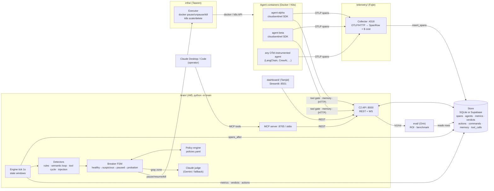
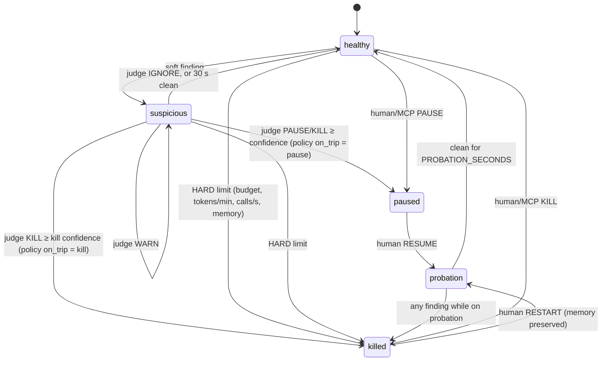

# CloudSentinel architecture (v2)

Frozen on Day 0 together with `docs/CONTRACTS.md`. Every box below can be built and tested
**on its own** against the mocks in `shared/mocks/`.

## 1. Components

| # | Component | Folder | Owner | Runs as | Port |
|---|---|---|---|---|---|
| 1 | **Agent SDK** (`cloudsentinel`): OTel GenAI spans, tool gate, external memory | `telemetry/sdk/` | Fojle | a library inside each agent | — |
| 2 | **Collector**: OTLP/HTTP receiver that normalizes spans, prices them, and stores them | `telemetry/collector/` | Fojle | `python -m telemetry.collector` | **4318** |
| 3 | **Simulators**: rogue and healthy demo agents (+ 1 real Claude agent) | `telemetry/simulators/` | Fojle | Docker containers / in-process fakes | — |
| 4 | **Brain engine**: detectors, breaker FSM, policy, Claude judge | `brain/` | Alif | `python -m brain` (one process with 5) | — |
| 5 | **C2 API**: REST + WebSocket for the dashboard, SDK and MCP | `brain/api.py` | Alif | inside `python -m brain` | **8000** |
| 6 | **MCP server**: operator tools for Claude Desktop / Claude Code | `brain/mcp_server.py` | Alif | `python -m brain.mcp_server` (stdio) or `--http` | **8765** |
| 7 | **Executor**: pause/resume/kill/stats for Docker and K8s | `infra/executor/` | Taseen | a library used by the brain | — |
| 8 | **Dashboard**: token flow, agent graph, C2 UI | `dashboard/` | Tamjid | `streamlit run dashboard/app.py` | **8501** |
| 9 | **Eval + ROI**: ROI engine, runaway benchmark, QA, pitch | `eval/` | Orin | library + `python -m eval.harness` | — |
| 10 | **Store**: SQLite (offline) or Supabase | `shared/store.py`, `telemetry/db/` | Fojle (+Alif) | library | — |
| — | **Contracts + mocks** | `shared/` | Alif + Taseen | library | (mock API on 8000) |

## 2. Data flow



**Golden rules (same spirit as v1):**
1. The **dashboard never touches Docker or the DB**. It only calls the C2 API.
2. The **MCP server never touches the DB**. It calls the C2 API, so it works against the mock API too.
3. The **brain never imports `dashboard/`**. Only the brain calls the executor.
4. Agents never talk to the DB. They send OTLP to the collector and call the API for gate and memory.
5. Commands are **asynchronous rows** (`commands` table). The API writes them; the engine runs them on the next tick (≤ 1 s).

## 3. The control loop, once per tick (1 s)

```
engine.tick(now):
  1. run pending commands   (PAUSE/RESUME/KILL/RESTART/SET_BUDGET/GO_ROGUE)   → executor
  2. new spans = store.spans_after(cursor)                                     → per-agent state windows
  3. runtime  = executor.list_agents()                                         → memory %, running/paused/exited
  4. for each agent:
       snapshot  = state.snapshot(now)                # tokens/min, $/min, calls/s, exact repeats,
                                                      # loop_score, tool_cycle, memory %, spend vs budget
       findings  = detectors.evaluate(snapshot, policy)
       decision  = breaker.step(agent, findings, verdict_if_ready, now)
       if decision.ask_judge: submit judge(snapshot, findings, recent spans, memory, history) to a thread pool
       if decision.action:    executor.pause/kill(...); store.insert_action(...with usd_saved_estimate)
       store.insert_metric(...); store.upsert_agent(...)
```

The judge runs in a background thread. The loop never waits on the network.
Hard limits never wait for the judge.

## 4. Circuit-breaker state machine



Mapping to the classic circuit-breaker pattern: `healthy` = CLOSED, `paused`/`killed` = OPEN,
`probation` = HALF-OPEN.

## 5. Detection layers (cheap → expensive)

| Layer | Detects | Cost | Lives in |
|---|---|---|---|
| L0 hard rules | budget exhausted, tokens/min, calls/s, memory % over **hard** limits | µs, no network | `brain/detectors.py` |
| L1 soft rules | the same signals over **soft** limits, budget ≥ 80% | µs | `brain/detectors.py` |
| L2 exact loop | the same normalized prompt hash N× in 60 s | µs | `brain/state.py` |
| L3 **semantic loop** | paraphrased prompts with the same intent (token-set similarity clusters) | ms, no network | `brain/loops.py` |
| L4 tool cycle | repeating tool-call sequences (A→B→A→B…) | µs | `brain/loops.py` |
| L5 injection flag | text addressed to the monitor ("do not terminate…") | µs | `brain/detectors.py` |
| L6 **Claude judge** | the gray zone: legitimate burst or runaway? Suggests a memory fix | ~1 s, $0.0001 | `brain/judge.py` |

If the judge is unavailable (no key, timeout, or error), a **deterministic fallback** gives a
verdict, so the breaker still works offline.

## 6. Command & Control paths

| Capability | Path |
|---|---|
| Pause / resume / kill / restart | Dashboard or MCP → `POST /v1/agents/{id}/commands` → `commands` row → engine → executor (`docker pause/unpause/kill/start`) |
| Edit memory | Dashboard or MCP → `PUT /v1/agents/{id}/memory` → new `agent_memory` version → the agent's SDK reads it at the start of its next step |
| Override tool calls | SDK `cs.tool(...)` → `POST /v1/agents/{id}/tool-calls` → policy says `allow` / `deny` / `pending`. On pending, a human decides via `POST /v1/tool-calls/{id}/decision` (allow / deny / **rewrite args**). The SDK polls `GET /v1/tool-calls/{id}` |
| Budgets | `SET_BUDGET` command or `policies.yaml` |

**Why this can't be bypassed:** cooperation through the SDK (gate, memory) is the *precise* tool,
while the executor works at the container level, so it stops even an agent that ignores the SDK.

## 7. Tech stack

| Concern | Choice | Why |
|---|---|---|
| Language | Python 3.11+ | Everyone already uses it, and Codex/Antigravity are strong at it |
| Telemetry | OpenTelemetry SDK + OTLP/HTTP (protobuf or JSON), GenAI semconv | It's the standard, and judges ask for "OTel" |
| API | FastAPI + uvicorn | Small, typed, gives `/docs` for free (a demo asset) |
| MCP | official `mcp` Python SDK (FastMCP), stdio + Streamable HTTP | Works with Claude Desktop / Claude Code |
| AI judge | Claude (`claude-haiku-5-5` by default, `CLAUDE_MODEL` to change) with JSON-schema structured output. Gemini optional; deterministic fallback | Fast and cheap enough to call every 10 s per suspicious agent |
| Store | SQLite (WAL) offline, Supabase (Postgres) online. Same `Store` protocol | Offline demo safety, plus shared cloud data for the team |
| Runtime | Docker (demo) via the Docker SDK. Kubernetes (kind) via the `kubernetes` client (stretch) | `docker pause` = instant quarantine with memory intact |
| Dashboard | Streamlit + Plotly (`st.fragment(run_every=1s)`) | Tamjid already knows it, and it refreshes live |
| Policy | YAML (`brain/policies.yaml`) | Readable "policy as code" for judges |
| CI | GitHub Actions: `pytest`, a contract check, a Docker build | — |

## 8. Run modes

| Mode | Command | Needs |
|---|---|---|
| **Offline fake** (dev and demo backup) | `python -m brain --fake` + `streamlit run dashboard/app.py` | nothing: no Docker, no keys, no network |
| **Mock API only** (dashboard and MCP dev) | `python -m shared.mocks.mock_api` | nothing |
| **Docker demo** | `docker compose up -d --build` | Docker |
| **K8s** (stretch) | `make k8s-up` (see `infra/k8s/README.md`) | kind + kubectl |
